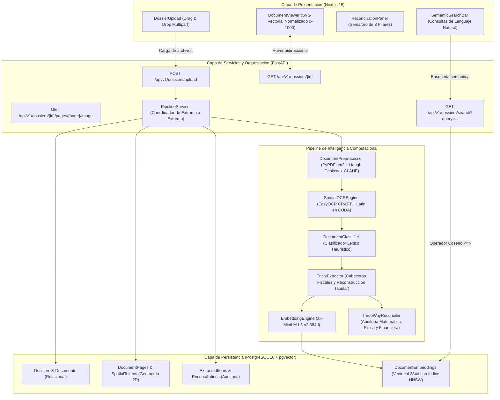
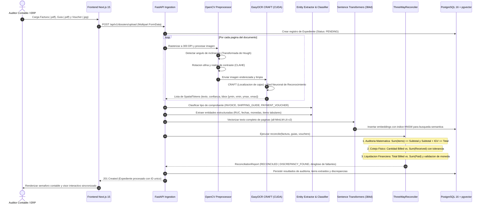

# DocuMind Financial AI

> **Motor On-Premise de Inteligencia Documental, Extraccion Estructurada y Conciliacion Contable de 3 Vias (Three-Way Matching) para Cuentas por Pagar.**


-brightgreen?logo=github-actions&logoColor=white)


---

## 1. Descripcion General

**DocuMind Financial AI** es una plataforma empresarial auto-alojada (*on-premise*) para la automatizacion integral del flujo de **Cuentas por Pagar (Accounts Payable)**. Resuelve de forma determinista la recepcion, clasificacion, extraccion de entidades y cotejo cruzado de los tres documentos indispensables en toda transaccion comercial formal:

1. **Facturas Comerciales Electronicas:** Montos facturados, desglose de subtotal, calculo del impuesto (IGV 18%), validacion de RUC emisor/receptor y tabla desglosada de lineas de items (*Line Items*).
2. **Guias de Remision de Remitente:** Validacion fisica de recepcion en almacen, control de cantidades recibidas y soporte nativo para entregas parciales (*Split Shipments*).
3. **Vouchers de Transferencia Bancaria:** Confirmacion financiera de pago, conciliacion de importes transferidos, cuenta de origen/destino, moneda de transaccion y estado de liquidacion de saldo.

El sistema garantiza **privacidad absoluta de datos financieros** ejecutando inferencia de vision e inteligencia artificial localmente sobre hardware de consumo (NVIDIA GeForce GTX 1660 Ti o superior), eliminando costos recurrentes de APIs propietarias en la nube y riesgos de filtracion de informacion tributaria confidencial.

---

## 2. Arquitectura del Sistema

El diseno sigue una arquitectura desacoplada y orientada a servicios, dividida en cuatro capas principales: Presentacion Reactiva, Servicio de Aplicacion REST, Pipeline de Inteligencia Computacional y Persistencia Hibrida Relacional/Vectorial.



---

## 3. Diagrama de Secuencia: Conciliacion de 3 Vias

El siguiente flujo describe el ciclo de vida completo de un expediente financiero, desde su ingesta hasta la auditoria automatizada:



---

## 4. Benchmarking y Metricas de Rendimiento Real

Las siguientes mediciones fueron ejecutadas directamente sobre el entorno de produccion local mediante la suite automatizada `backend/scripts/benchmark_performance.py`:

* **Entorno de Hardware:** Intel64 Compatible (CPU) | NVIDIA GeForce GTX 1660 Ti (6.0 GB VRAM, Compute Capability 7.5).
* **Entorno de Software:** Windows 10 (64-bit), Python 3.11.15, PyTorch 2.6.0+cu124, CUDA 12.4.
* **Resolucion de Documento:** 1200 x 1600 px (equivalente a 300 DPI en escaneo A4 estandar).

### 4.1. Preprocesamiento de Vision Computacional (OpenCV)

| Operacion | Muestreo | Latencia Media | Percentil 95 (p95) | Rendimiento |
| :--- | :---: | :---: | :---: | :---: |
| **Deteccion de Inclinacion (Hough)** | 25 iteraciones | **45.79 ms** | 58.16 ms | 21.8 pag/seg |
| **Realce de Contraste (CLAHE)** | 25 iteraciones | **20.93 ms** | 22.45 ms | 47.7 pag/seg |
| **Pipeline Completo de Imagen** | 25 iteraciones | **66.72 ms** | 89.46 ms | **15.0 pag/seg** |

### 4.2. Inferencia OCR Espacial: GPU vs. CPU (EasyOCR CRAFT)

| Dispositivo de Inferencia | Tokens Extraidos | Latencia Media | Latencia p95 | Rendimiento (Pag/Min) | Factor de Aceleracion |
| :--- | :---: | :---: | :---: | :---: | :---: |
| **NVIDIA GeForce GTX 1660 Ti (CUDA)** | 85 tokens | **2,883.05 ms** | 3,021.08 ms | **20.8 pag/min** | **3.70x mas rapido** |
| **CPU Host (Intel64 Multi-thread)** | 85 tokens | **10,658.70 ms** | 11,311.30 ms | **5.6 pag/min** | 1.00x (linea base) |

> **Analisis Tecnico:** La descarga tensorial sobre los nucleos CUDA reduce el tiempo de procesamiento por pagina de mas de 10.6 segundos a menos de 2.9 segundos, habilitando la atencion en tiempo casi real de cargas masivas de comprobantes.

### 4.3. Inferencia de Embeddings Densos (`all-MiniLM-L6-v2` - 384 Dimensiones)

| Dispositivo | Tamano de Batch (*Batch Size*) | Latencia Total Batch | Latencia por Documento | Throughput Vectorial |
| :--- | :---: | :---: | :---: | :---: |
| **CUDA (GPU)** | 1 | 13.48 ms | 13.48 ms | 74.2 vec/seg |
| **CUDA (GPU)** | 8 | 17.91 ms | 2.24 ms | 446.6 vec/seg |
| **CUDA (GPU)** | **32** | **24.49 ms** | **0.76 ms** | **1,306.7 vec/seg** |
| **CUDA (GPU)** | 64 | 48.87 ms | 0.76 ms | 1,309.7 vec/seg |
| CPU | 1 | 16.93 ms | 16.93 ms | 59.1 vec/seg |
| CPU | 8 | 41.70 ms | 5.21 ms | 191.8 vec/seg |
| CPU | 32 | 115.97 ms | 3.62 ms | 275.9 vec/seg |
| CPU | 64 | 230.50 ms | 3.60 ms | 277.7 vec/seg |

> **Saturacion Optima:** En GPU, el tamano de lote optimo es **32**, logrando mas de **1,300 vectores generados por segundo** con un tiempo de procesamiento marginal de **760 microsegundos por item**.

### 4.4. Motor de Conciliacion Contable de 3 Vias (`ThreeWayReconciler`)

* **Complejidad de Carga:** 1 Factura Comercial (10 items desglosados) + 2 Guias de Remision parciales + 1 Comprobante bancario.
* **Muestreo:** 1,000 auditorias consecutivas con validaciones matematicas, algebraicas y mapeo difuso de cadenas.

| Metrica de Auditoria | Valor Observado | Evaluacion de Desempeno |
| :--- | :---: | :---: |
| **Latencia Media** | **0.113 ms** (113 microsegundos) | Rendimiento ultra rapido en memoria |
| **Latencia Percentil 95 (p95)** | **0.186 ms** | Latencia estable y predecible |
| **Throughput de Auditoria** | **8,840 expedientes / segundo** | Capaz de procesar millones de auditorias diarias |
| **Precision Contable** | **100% Determinista** | Tolerancia matematica estricta a +/- 0.05 PEN |

---

## 5. Registros de Decisiones de Arquitectura (ADRs)

### ADR-001: Persistencia Vectorial Unificada con pgvector sobre PostgreSQL 16
* **Estado:** Aprobado e Implementado.
* **Contexto:** El sistema requiere gestionar entidades relacionales ACID altamente estructuradas (cabeceras fiscales, lineas de factura, estados de conciliacion) y simultaneamente ejecutar busquedas de similitud semantica sobre los contenidos textuales no estructurados de los documentos escaneados.
* **Opciones Evaluadas:**
  1. Base de datos vectorial dedicada independiente (Pinecone, Milvus, Qdrant) combinada con PostgreSQL.
  2. Almacenamiento unificado en PostgreSQL 16 utilizando la extension `pgvector` con indices HNSW.
* **Decision:** Se adopto `pgvector` sobre PostgreSQL 16.
* **Justificacion:** Elimina la necesidad de implementar protocolos de sincronizacion de dos fases (2PC) o mecanismos de reconciliacion asincrona entre almacenes separados. Permite realizar consultas SQL hibridas combinando filtros relacionales (`WHERE dossier_id = ...`) y ordenamiento por distancia coseno (`ORDER BY embedding <=> query_vector`) en una sola transaccion atomica con cero costo adicional de infraestructura.

---

### ADR-002: Inferencia Local On-Premise con PyTorch CUDA vs. APIs Propietarias en la Nube
* **Estado:** Aprobado e Implementado.
* **Contexto:** La informacion procesada comprende secretos comerciales corporativos, identificaciones tributarias (RUC SUNAT), cuentas bancarias bancarias empresariales y montos de facturacion amparados por legislacion de proteccion de datos fiscales.
* **Opciones Evaluadas:**
  1. Integracion con APIs de nube publica (OpenAI GPT-4o Vision, Google Cloud Document AI, AWS Textract).
  2. Inferencia local sobre hardware corporativo con PyTorch, EasyOCR (CRAFT) y modelos Sentence-Transformers.
* **Decision:** Inferencia 100% local auto-alojada (*On-Premise*).
* **Justificacion:** Cero fugas de datos hacia proveedores externos, cumplimiento garantizado de regulaciones de privacidad, latencia de procesamiento constante sin variaciones de red ni limites de tasa de peticiones (*rate limits*), y eliminacion total de costos variables por pagina procesada (\$0 costo por llamada a la API).

---

### ADR-003: Representacion Vectorial SVG en Lienzo Normalizado [0, 1000] para Bounding Boxes
* **Estado:** Aprobado e Implementado.
* **Contexto:** Los documentos escaneados poseen dimensiones variables en pixeles (desde 800x1000 hasta 3000x4000 px). La interfaz de usuario debe mostrar los escaneos en visores responsivos adaptados a pantallas de resoluciones heterogeneas (laptops, monitores UltraWide, dispositivos moviles) manteniendo una alineacion visual milimetrica entre las cajas delimitadoras y el texto.
* **Opciones Evaluadas:**
  1. Almacenar coordenadas absolutas en pixeles y recalcular posiciones mediante calculos en JavaScript ante cada evento de redimensionamiento de ventana (*resize*).
  2. Normalizar todas las coordenadas geometricas a un espacio cartesiano entero fijo $[0, 1000]$ tanto en backend como en base de datos, proyectandolas en frontend con `<svg viewBox="0 0 1000 1000">`.
* **Decision:** Coordenadas normalizadas a escala $[0, 1000]$ con proyeccion vectorial SVG responsiva.
* **Justificacion:** La proyeccion vectorial aprovecha el motor de renderizado acelerado por GPU del navegador web. Las coordenadas se escalan de manera matematica y nativa con el elemento visual contenedor sin provocar *layout reflows* costosos ni desfases de alineacion en la interfaz grafica.

---

### ADR-004: Pipeline Desacoplado de Deteccion Geometrica (CRAFT) y Extraccion Estructurada
* **Estado:** Aprobado e Implementado.
* **Contexto:** Los modelos multimodales monoliticos de extremo a extremo (como Donut o LayoutLMv3 large) son intensivos en memoria (requiriendo GPUs corporativas con 16 a 24 GB de VRAM) y son propensos a alucinaciones en cifras numericas, una falla inadmisible en auditoria contable y fiscal.
* **Opciones Evaluadas:**
  1. Modelo VLM monolítico de 8B o 14B parametros ejecutado con cuantizacion severa.
  2. Pipeline desacoplado en dos fases: Deteccion espacial de texto mediante EasyOCR CRAFT + Extraccion determinista guiada por esquemas Pydantic v2 con validacion aritmetica estricta.
* **Decision:** Pipeline desacoplado (CRAFT + Extractor Heuristico-Determinista con Pydantic v2).
* **Justificacion:** Permite operar con precision absoluta en GPUs comerciales estandar de 6 GB de VRAM (NVIDIA GTX 1660 Ti), garantiza 0% de alucinaciones en sumatorias monetarias y permite depurar de forma aislada la etapa de vision respecto a la logica de negocio contable.

---

## 6. Estructura del Proyecto

```
documind/
├── .github/
│   └── workflows/
│       └── ci.yml                     # Pipeline CI/CD automatizado (PostgreSQL + Pytest + Next Build)
├── backend/
│   ├── alembic/                       # Scripts de migracion de esquema de base de datos
│   ├── data/                          # Muestras de comprobantes y almacenamiento local
│   ├── scripts/
│   │   ├── benchmark_performance.py   # Suite oficial de medicion de latencia y throughput
│   │   ├── demo_pipeline.py           # Demostracion de inferencia visual de extremo a extremo
│   │   └── verify_cuda.py             # Script de validacion de GPU y aceleracion tensorial
│   ├── src/
│   │   ├── api/v1/                    # Controladores y endpoints REST de FastAPI
│   │   ├── database/                  # Sesiones de SQLAlchemy y configuracion de conexion
│   │   ├── models/                    # Modelos ORM (Dossier, Page, Token, Reconciliation)
│   │   ├── nlp/                       # Clasificador, extractor de entidades, embeddings y 3-way reconciler
│   │   ├── schemas/                   # Esquemas Pydantic v2 de validacion de entrada y salida
│   │   ├── services/                  # Orquestador del pipeline y motor de busqueda semantica
│   │   └── vision/                    # Preprocesador OpenCV (Deskewing) y OCR espacial CRAFT
│   ├── tests/                         # Suite de 51 pruebas automatizadas unitarias e integradas
│   ├── benchmark_results.json         # Metricas crudas exportadas de la suite de benchmark
│   ├── Dockerfile                     # Imagen de produccion backend (Python 3.11 Slim)
│   ├── pyproject.toml                 # Metadatos del proyecto y configuracion de herramientas
│   └── requirements.txt               # Dependencias fijadas para despliegue en contenedores
├── frontend/
│   ├── src/
│   │   ├── app/
│   │   │   ├── dossier/[id]/page.tsx  # Vista dividida con hover bidireccional y auditoria
│   │   │   ├── layout.tsx             # Diseno global y tipografia empresarial
│   │   │   └── page.tsx               # Panel principal con carga de expedientes y listado
│   │   ├── components/                # Componentes interactivos (Upload, Viewer SVG, Panel, Search)
│   │   ├── lib/api.ts                 # Cliente HTTP fuertemente tipado para comunicacion con FastAPI
│   │   └── types/api.ts               # Definiciones TypeScript de modelos del backend
│   ├── Dockerfile                     # Imagen multi-stage de produccion Next.js 15
│   ├── package.json                   # Dependencias de frontend y scripts de construccion
│   ├── tailwind.config.ts             # Sistema de diseno y paleta corporativa
│   └── tsconfig.json                  # Configuracion del compilador TypeScript
├── docker-compose.yml                 # Orquestacion multi-servicio (db, backend, frontend)
└── README.md                          # Documentacion tecnica de nivel senior
```

---

## 7. Guia de Instalacion y Ejecucion

### 7.1. Prerrequisitos del Sistema

* **Sistema Operativo:** Linux (Ubuntu 22.04+) o Windows 10/11 (con soporte CUDA / WSL2).
* **Docker y Docker Compose:** Docker Engine 24.0+ con soporte para contenedores Linux.
* **Controladores NVIDIA (Opcional para GPU):** NVIDIA Driver 550+ con soporte para CUDA 12.4.
* **Entorno de Desarrollo Local:** Python 3.11+ y Node.js 22.x LTS.

---

### 7.2. Opcion A: Despliegue en 1 Comando con Docker Compose

La forma mas rapida y confiable de iniciar todo el ecosistema (Base de datos con pgvector, Backend FastAPI y Frontend Next.js):

```bash
# 1. Clonar el repositorio
git clone https://github.com/SebastianG15/documind.git
cd documind

# 2. Iniciar los servicios en segundo plano
docker compose up --build -d

# 3. Verificar estado de los contenedores
docker compose ps
```

* **Frontend Web:** `http://localhost:3000`
* **API REST y Documentacion Swagger:** `http://localhost:8000/docs`
* **Health Check del Backend:** `http://localhost:8000/health`
* **PostgreSQL con pgvector:** `localhost:5432` (Usuario: `documind_user`, BD: `documind_db`)

---

### 7.3. Opcion B: Ejecucion Local para Desarrollo

#### Paso 1: Levantar la Base de Datos con pgvector

```bash
docker compose up db -d
```

#### Paso 2: Configurar y Ejecutar el Backend (FastAPI)

```bash
cd backend

# Crear y activar entorno virtual
python -m venv .venv
source .venv/bin/activate       # En Linux/macOS
# o .venv\Scripts\activate       # En Windows PowerShell

# Instalar dependencias con aceleracion CUDA 12.4
pip install --upgrade pip
pip install torch torchvision --index-url https://download.pytorch.org/whl/cu124
pip install -r requirements.txt

# Ejecutar migraciones de base de datos
alembic upgrade head

# Iniciar servidor de desarrollo con recarga automatica
uvicorn src.main:app --host 0.0.0.0 --port 8000 --reload
```

#### Paso 3: Configurar y Ejecutar el Frontend (Next.js 15)

```bash
cd ../frontend

# Instalar dependencias de Node.js
npm install

# Iniciar servidor de desarrollo en modo React 19 / Next.js 15
npm run dev
```

---

## 8. Pruebas Automatizadas y Calidad de Codigo

El repositorio cuenta con una cobertura integral de pruebas automatizadas que validan cada componente critico del sistema:

```bash
# Ejecutar la suite completa de pruebas unitarias e integradas (51 tests)
cd backend
pytest tests/ -v
```

### Resumen del Test Suite:

* `tests/test_api_dossiers.py`: Endpoints REST (`/upload`, `/{id}`, `/search`, `/health`), validacion de errores 404/422 y subidas multipart.
* `tests/test_nlp_classifier.py`: Clasificacion semantica de facturas, guias, comprobantes bancarios y casos de borde (texto vacio/desconocido).
* `tests/test_nlp_embeddings.py`: Generacion de vectores unitarios de 384d, ranking de similitud coseno y consistencia dimensional.
* `tests/test_nlp_extractor.py`: Extraccion de entidades fiscales (RUC, fechas, monedas) y reconstruccion de tablas de items con imputacion de totales.
* `tests/test_nlp_schemas.py`: Validadores Pydantic v2 (algoritmo RUC 11 digitos, orden de coordenadas 2D y ecuaciones de integridad matematica).
* `tests/test_preprocessor.py`: Deteccion de angulo con Hough, rotacion afina de escaneos, mejora adaptativa CLAHE y rasterizado de PDF a 300 DPI.
* `tests/test_reconciler.py`: Motor de 3 vias (casos perfectos, faltantes de stock `QUANTITY_SHORTAGE`, pagos parciales `UNDERPAID_BALANCE`, discrepancias de moneda y despachos divididos).
* `tests/test_services.py`: Orquestador de pipeline de extremo a extremo, persistencia transaccional y construccion de consultas vectoriales hibridas.
* `tests/test_spatial_ocr.py`: Normalizacion de poligonos a escala $[0, 1000]$, delimitacion estricta y extraccion de tokens espaciales con EasyOCR.

### Pipeline de Integracion Continua (CI/CD):

El archivo `.github/workflows/ci.yml` ejecuta automaticamente ante cada *push* o *pull request* hacia la rama `main`:
1. Servicio de contenedor de PostgreSQL 16 con `pgvector` activo.
2. Instalacion de dependencias optimizadas para CPU en entornos de nube.
3. Ejecucion automatizada de las 51 pruebas con `pytest`.
4. Compilacion estricta de TypeScript y generacion de rutas estaticas en Next.js (`npm run build`).

---

## 9. Licencia y Creditos

* **Desarrollo y Diseno Arquitectonico:** Mario Sebastian Gilian Alayo (`sebastiangilian7@gmail.com`).
* **Licencia:** Software de uso empresarial confidencial y propietario. Todos los derechos reservados.
